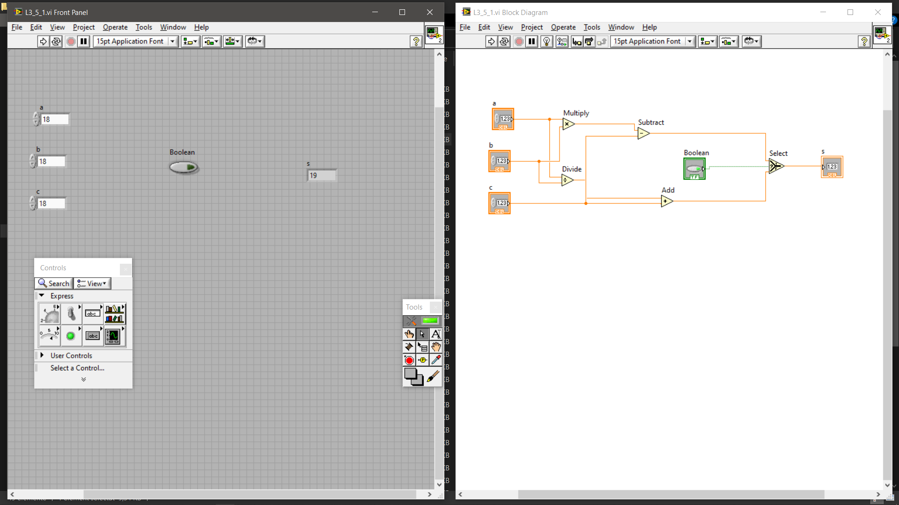
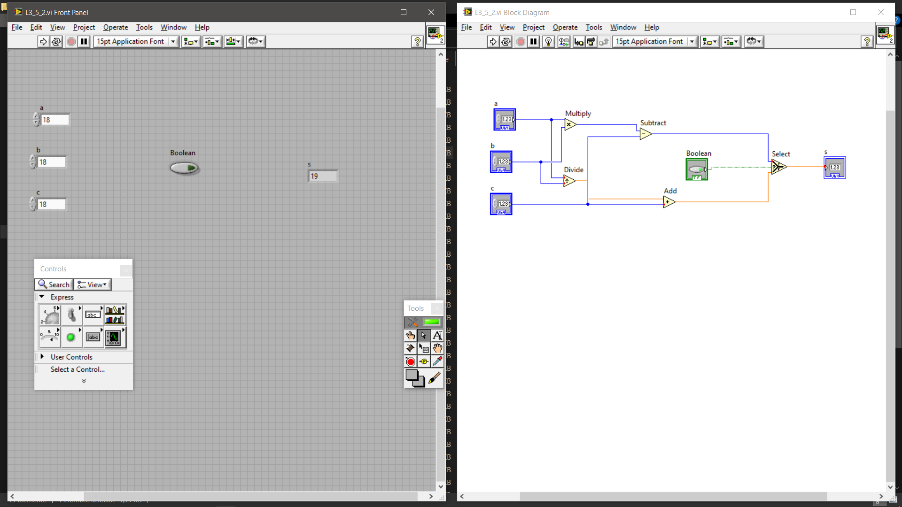
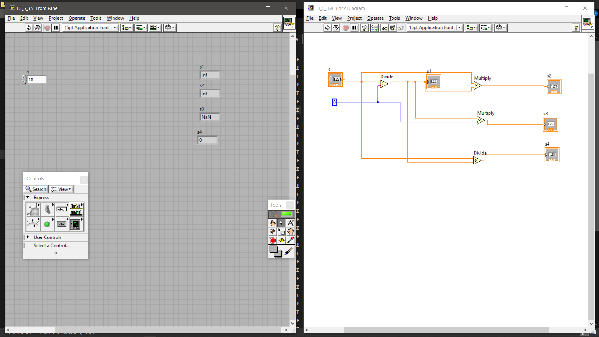
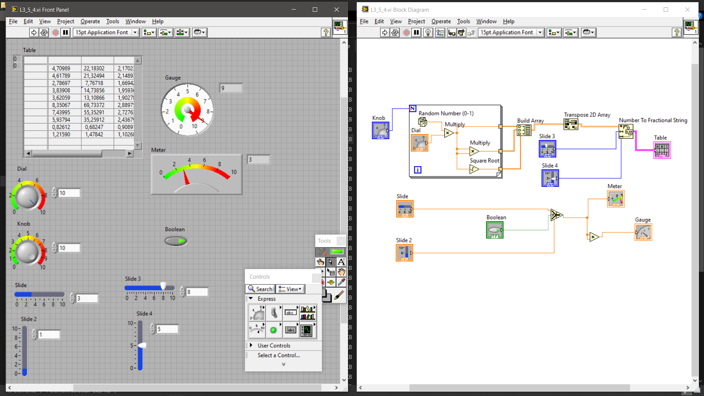
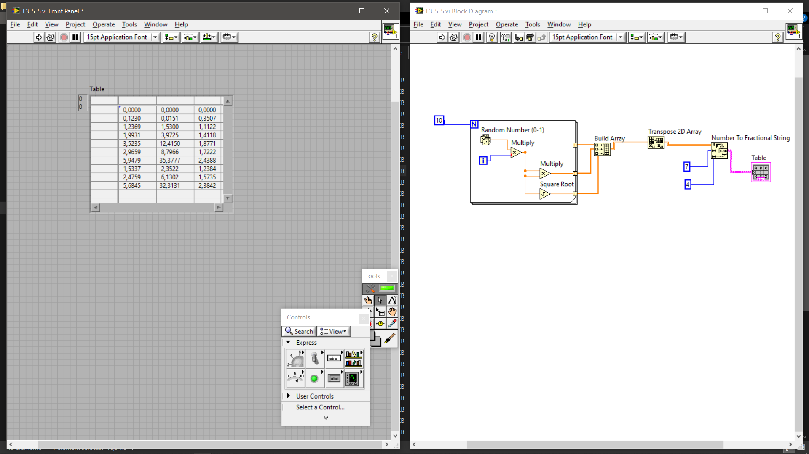
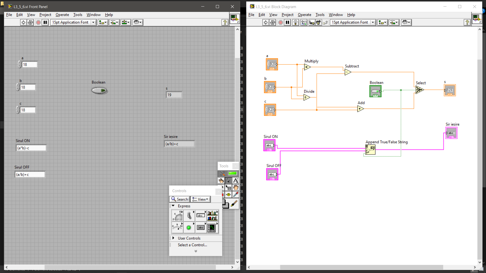

# Aplicații de calcul și prelucrare a datelor în LabVIEW

## 🇷🇴 Română

### Despre proiect

Acest proiect prezintă o colecție de șase aplicații dezvoltate în **LabVIEW**, axate pe operații matematice, logică booleană, generarea numerelor aleatoare și prelucrarea datelor numerice.

Proiectele demonstrează utilizarea programării grafice pentru construirea unor aplicații interactive, implementarea fluxurilor de date, utilizarea structurilor repetitive și condiționale, manipularea tablourilor și afișarea rezultatelor prin intermediul interfețelor grafice.

Fiecare aplicație include:
- **Front Panel** – interfața grafică prin care utilizatorul introduce date și vizualizează rezultatele;
- **Block Diagram** – reprezentarea logicii de programare și a conexiunilor dintre funcțiile utilizate.

Scopul proiectului este de a evidenția aplicarea conceptelor de programare grafică în realizarea unor aplicații funcționale pentru calcule și prelucrarea datelor.

## Aplicații dezvoltate

### 1. Operații matematice cu selecție booleană

**Fișier:** `L3_5_1.vi`

Aplicația efectuează operații matematice asupra a trei valori numerice, alegerea operației fiind controlată printr-un selector boolean.

**Intrări:**
- `a` – prima valoare numerică;
- `b` – a doua valoare numerică;
- `c` – a treia valoare numerică;
- `Boolean` – selectorul logic care determină operația executată.

**Logică de funcționare:**

În funcție de starea selectorului boolean, aplicația execută una dintre următoarele operații:

- `TRUE`: \(s = (a \times b) - c\)
- `FALSE`: \(s = (a / b) + c\)

**Ieșire:**
- `s` – rezultatul operației selectate.

**Exemplu de funcționare:**

Pentru valorile `a = 6`, `b = 2`, `c = 3`:

| Stare Boolean | Calcul | Rezultat |
|---|---|---:|
| TRUE | (6 × 2) − 3 | 9 |
| FALSE | (6 / 2) + 3 | 6 |

**Concepte demonstrate:**
- operații aritmetice;
- selecție condițională;
- utilizarea valorilor booleene;
- transmiterea și selectarea datelor în Block Diagram.

**Captură Front Panel și Block Diagram:**



---

### 2. Operații matematice cu numere întregi U8

**Fișier:** `L3_5_2.vi`

Aplicația implementează un mecanism de calcul similar celui din aplicația precedentă, utilizând valori numerice de tip `U8` (unsigned 8-bit integer).

**Intrări:**
- `a` – prima valoare numerică;
- `b` – a doua valoare numerică;
- `c` – a treia valoare numerică;
- `Boolean` – selectorul logic.

**Logică de funcționare:**

- `TRUE`: \(s = (a \times b) - c\)
- `FALSE`: \(s = (a / b) + c\)

Aplicația evidențiază utilizarea tipurilor de date întregi fără semn în operații matematice și în selectarea condițională a rezultatelor.

**Ieșire:**
- `s` – rezultatul operației selectate.

**Exemplu de funcționare:**

Pentru `a = 6`, `b = 2`, `c = 3`:

| Stare Boolean | Calcul | Rezultat matematic |
|---|---|---:|
| TRUE | (6 × 2) − 3 | 9 |
| FALSE | (6 / 2) + 3 | 6 |

Exemplul utilizează valori care permit evitarea depășirii intervalului de reprezentare U8. Rezultatul efectiv trebuie interpretat ținând cont de tipurile și regulile de conversie ale operațiilor LabVIEW.

**Concepte demonstrate:**
- tipuri de date numerice;
- utilizarea reprezentării U8;
- operații aritmetice;
- selecție booleană;
- conectarea funcțiilor în programarea grafică.

**Captură Front Panel și Block Diagram:**



---

### 3. Analiza operațiilor matematice cu împărțire la zero

**Fișier:** `L3_5_3.vi`

Aplicația analizează comportamentul operațiilor matematice în cazul utilizării valorii zero ca divizor și modul în care rezultatele speciale influențează calculele ulterioare.

**Intrări:**
- `a` – valoarea numerică introdusă;
- `0` – valoare constantă utilizată în operații.

**Operații executate:**

- `s1 = a / 0`
- `s2 = s1 × a`
- `s3 = s1 × 0`
- `s4 = a / s1`

**Ieșiri:**
- `s1` – rezultatul primei împărțiri;
- `s2` – rezultatul înmulțirii;
- `s3` – rezultatul înmulțirii cu zero;
- `s4` – rezultatul ultimei împărțiri.

**Exemplu de comportament:**

Pentru o valoare pozitivă finită a lui `a`, în aritmetica în virgulă mobilă, rezultatele pot fi:

| Variabilă | Operație | Rezultat |
|---|---|---|
| s1 | a / 0 | Inf |
| s2 | Inf × a | Inf |
| s3 | Inf × 0 | NaN |
| s4 | a / Inf | 0 |

Rezultatele depind de tipul numeric și de comportamentul funcțiilor utilizate în LabVIEW.

**Concepte demonstrate:**
- operații cu numere în virgulă mobilă;
- împărțire la zero;
- valori speciale `Inf` și `NaN`;
- propagarea valorilor speciale în calcule;
- analiza comportamentului operațiilor matematice.

**Captură Front Panel și Block Diagram:**



---

### 4. Generarea numerelor aleatoare și prelucrarea datelor

**Fișier:** `L3_5_4.vi`

Aplicația generează valori aleatoare și efectuează operații matematice asupra acestora. Rezultatele sunt organizate într-un tablou bidimensional și afișate prin intermediul elementelor grafice ale interfeței.

**Intrări și controale:**
- `Knob` – controlează numărul de iterații;
- `Dial` – parametru numeric utilizat în prelucrarea valorilor aleatoare;
- `Slide` – prima valoare numerică utilizată în selecția logică;
- `Slide 2` – a doua valoare numerică utilizată în selecția logică;
- `Boolean` – controlează selectarea valorii transmise către indicator;
- `Slide 3` și `Slide 4` – parametri utilizați în configurarea formatării numerice.

**Logică de funcționare:**

Aplicația utilizează o structură repetitivă pentru generarea și prelucrarea datelor.

În cadrul procesării:
1. Sunt generate numere aleatoare în intervalul `[0, 1)`.
2. Valorile generate sunt prelucrate prin operații de înmulțire.
3. Sunt calculate valori derivate prin ridicare la pătrat și extragerea rădăcinii pătrate.
4. Rezultatele sunt organizate într-un tablou bidimensional.
5. Tabloul este transpus pentru organizarea datelor.
6. Valorile numerice sunt convertite în șiruri de caractere pentru afișare.

Un selector boolean determină valoarea transmisă către indicatorul `Meter`. Valoarea selectată este utilizată ulterior pentru calcularea pătratului, rezultatul fiind transmis către indicatorul `Gauge`.

**Ieșiri:**
- `Table` – tabel cu valorile generate și prelucrate;
- `Meter` – valoarea numerică selectată;
- `Gauge` – pătratul valorii selectate.

**Concepte demonstrate:**
- generarea numerelor aleatoare;
- utilizarea structurilor repetitive;
- operații matematice asupra datelor;
- selecție booleană;
- construire și transpunere de tablouri bidimensionale;
- conversie numerică în șiruri de caractere;
- utilizarea indicatorilor grafici.

**Captură Front Panel și Block Diagram:**



---

### 5. Generarea și organizarea unui set de valori numerice

**Fișier:** `L3_5_5.vi`

Aplicația generează automat un set de valori aleatoare și calculează rezultate matematice pentru fiecare iterație a unei bucle cu 10 repetări.

**Intrări:**

Aplicația folosește un număr fix de 10 iterații și nu necesită introducerea unor valori numerice de către utilizator.

**Logică de funcționare:**

Pentru fiecare iterație:
1. Este generat un număr aleatoriu în intervalul `[0, 1)`.
2. Este utilizat indexul curent al buclei (`i`).
3. Numărul aleatoriu este înmulțit cu indexul iterației.
4. Sunt calculate valori derivate, inclusiv rădăcina pătrată a rezultatului.
5. Valorile obținute sunt organizate într-un tablou bidimensional.
6. Tabloul este transpus.
7. Valorile numerice sunt convertite în șiruri de caractere fracționare.

**Ieșire:**
- `Table` – tabel cu 10 rânduri și 3 coloane, care organizează valorile generate și rezultatele calculelor.

**Concepte demonstrate:**
- bucle cu număr fix de iterații;
- utilizarea indexului unei bucle;
- generarea numerelor aleatoare;
- operații matematice;
- construirea și transpunerea tablourilor;
- formatarea și afișarea datelor numerice.

**Captură Front Panel și Block Diagram:**



---

### 6. Operații matematice și selecția condițională a mesajelor text

**Fișier:** `L3_5_6.vi`

Aplicația combină operațiile matematice cu selectarea condițională a unui rezultat numeric și a unui mesaj text, în funcție de starea unui selector boolean.

**Intrări:**
- `a` – prima valoare numerică;
- `b` – a doua valoare numerică;
- `c` – a treia valoare numerică;
- `Boolean` – selectorul logic;
- `Sirul ON` – mesajul text corespunzător stării TRUE;
- `Sirul OFF` – mesajul text corespunzător stării FALSE.

**Logică de funcționare:**

Aplicația realizează operații de înmulțire, împărțire, adunare și scădere.

Rezultatele sunt transmise către o funcție de selecție, care alege valoarea numerică în funcție de starea selectorului boolean:

- `TRUE`: \(s = (a \times b) - c\)
- `FALSE`: \(s = (a / b) + c\)

În paralel, funcția `Append True/False String` selectează mesajul text corespunzător stării logice.

**Ieșiri:**
- `s` – rezultatul numeric selectat;
- `Sir iesire` – mesajul text selectat.

**Exemplu de funcționare:**

Pentru `a = 6`, `b = 2`, `c = 3`:

| Stare Boolean | Rezultat numeric |
|---|---:|
| TRUE | 9 |
| FALSE | 6 |

Mesajul afișat în `Sir iesire` depinde de șirul introdus în controlul corespunzător (`Sirul ON` sau `Sirul OFF`).

**Concepte demonstrate:**
- operații aritmetice;
- selecție condițională;
- procesarea datelor numerice și text;
- utilizarea funcțiilor pentru șiruri de caractere;
- implementarea logicii booleene;
- gestionarea mai multor tipuri de date în aceeași aplicație.

**Captură Front Panel și Block Diagram:**



---

## Competențe tehnice demonstrate

Prin realizarea acestor aplicații sunt demonstrate următoarele competențe:

- Dezvoltarea aplicațiilor utilizând programarea grafică în LabVIEW.
- Implementarea operațiilor matematice și a expresiilor numerice.
- Utilizarea structurilor repetitive și a fluxurilor de date.
- Implementarea logicii condiționale prin selectoare booleene.
- Lucrul cu tipuri de date numerice și conversii.
- Generarea și prelucrarea numerelor aleatoare.
- Construirea, manipularea și transpunerea tablourilor.
- Conversia și formatarea datelor numerice pentru afișare.
- Utilizarea controalelor și indicatorilor din interfețele grafice.
- Organizarea logicii aplicațiilor în Block Diagram.

## Tehnologii și funcționalități utilizate

- **LabVIEW** – mediu de dezvoltare bazat pe programare grafică;
- Front Panel și Block Diagram;
- funcții matematice;
- structuri repetitive și condiționale;
- valori booleene;
- tipuri numerice, inclusiv U8;
- generarea numerelor aleatoare;
- tablouri și tablouri bidimensionale;
- funcții de transpunere a tablourilor;
- conversie numerică în șiruri de caractere;
- controale și indicatori grafici.

## Structura proiectului

```text
labview-calcul-si-prelucrare-date/
│
├── VI/
│   ├── L3_5_1.vi
│   ├── L3_5_2.vi
│   ├── L3_5_3.vi
│   ├── L3_5_4.vi
│   ├── L3_5_5.vi
│   └── L3_5_6.vi
│
├── Imagini/
│   ├── L3-1.png
│   ├── L3-2.png
│   ├── L3-3.png
│   ├── L3-4.png
│   ├── L3-5.png
│   └── L3-6.png
│
└── README.md
```

## Instalare și rulare

Pentru deschiderea și rularea aplicațiilor:

1. Instalați LabVIEW.
2. Descărcați repository-ul sau clonați-l utilizând Git.
3. Deschideți folderul `VI`.
4. Selectați fișierul `.vi` dorit.
5. Deschideți aplicația în LabVIEW.
6. Configurați valorile de intrare, dacă este cazul.
7. Apăsați butonul **Run** pentru executarea aplicației.

## Observații tehnice

- În aplicațiile care efectuează împărțiri, trebuie evitată utilizarea valorii zero ca divizor, cu excepția aplicației dedicate analizei acestui caz.
- Tipul numeric `U8` reprezintă un întreg fără semn pe 8 biți, cu intervalul de reprezentare 0–255. Rezultatele operațiilor depind de tipurile de date și de regulile de conversie aplicate.
- Valorile `Inf` și `NaN` sunt rezultate speciale întâlnite în operațiile în virgulă mobilă. Comportamentul exact depinde de tipul numeric și de funcțiile utilizate.
- Numerele aleatoare sunt generate la execuția aplicațiilor, astfel încât rezultatele pot varia între rulări.

---

# LabVIEW Applications for Mathematical Operations and Data Processing

## 🇬🇧 English

### About the Project

This project contains a collection of six applications developed in **LabVIEW**, focusing on mathematical operations, Boolean logic, random number generation, and numerical data processing.

The projects demonstrate the use of graphical programming to develop interactive applications, implement data flow, use iterative and conditional structures, manipulate arrays, and display results through graphical interfaces.

Each application includes:
- **Front Panel** – the graphical interface used to enter data and display results;
- **Block Diagram** – the graphical representation of the application logic and connections between functions.

The project aims to demonstrate the practical use of graphical programming concepts in developing functional applications for calculations and data processing.

## Developed Applications

### 1. Mathematical Operations with Boolean Selection

**File:** `L3_5_1.vi`

This application performs mathematical operations on three numeric values. The selected operation is controlled by a Boolean selector.

**Inputs:**
- `a` – first numeric value;
- `b` – second numeric value;
- `c` – third numeric value;
- `Boolean` – logical selector determining the operation.

**Operating Logic:**

Depending on the Boolean selector state, the application performs one of the following operations:

- `TRUE`: \(s = (a \times b) - c\)
- `FALSE`: \(s = (a / b) + c\)

**Output:**
- `s` – result of the selected operation.

**Example:**

For `a = 6`, `b = 2`, and `c = 3`:

| Boolean State | Calculation | Result |
|---|---|---:|
| TRUE | (6 × 2) − 3 | 9 |
| FALSE | (6 / 2) + 3 | 6 |

**Demonstrated Concepts:**
- arithmetic operations;
- conditional selection;
- Boolean values;
- data flow and selection in the Block Diagram.

**Front Panel and Block Diagram:**


---

### 2. Mathematical Operations Using U8 Integers

**File:** `L3_5_2.vi`

This application implements a calculation mechanism similar to the previous application, using `U8` numeric values (unsigned 8-bit integers).

**Inputs:**
- `a` – first numeric value;
- `b` – second numeric value;
- `c` – third numeric value;
- `Boolean` – logical selector.

**Operating Logic:**

- `TRUE`: \(s = (a \times b) - c\)
- `FALSE`: \(s = (a / b) + c\)

The application demonstrates the use of unsigned integer data types in mathematical operations and conditional result selection.

**Output:**
- `s` – result of the selected operation.

**Example:**

For `a = 6`, `b = 2`, and `c = 3`:

| Boolean State | Calculation | Mathematical Result |
|---|---|---:|
| TRUE | (6 × 2) − 3 | 9 |
| FALSE | (6 / 2) + 3 | 6 |

The example uses values that avoid exceeding the U8 representation range. The actual result must be interpreted according to the data types and conversion rules applied by LabVIEW operations.

**Demonstrated Concepts:**
- numeric data types;
- U8 representation;
- arithmetic operations;
- Boolean selection;
- graphical function wiring.

**Front Panel and Block Diagram:**


---

### 3. Analysis of Mathematical Operations Involving Division by Zero

**File:** `L3_5_3.vi`

This application examines the behavior of mathematical operations when zero is used as a divisor and how special results affect subsequent calculations.

**Inputs:**
- `a` – numeric value entered by the user;
- `0` – constant value used in the operations.

**Operations Performed:**

- `s1 = a / 0`
- `s2 = s1 × a`
- `s3 = s1 × 0`
- `s4 = a / s1`

**Outputs:**
- `s1` – result of the first division;
- `s2` – multiplication result;
- `s3` – result of multiplication by zero;
- `s4` – result of the final division.

**Example of Behavior:**

For a positive finite value of `a`, using floating-point arithmetic, the results may be:

| Variable | Operation | Result |
|---|---|---|
| s1 | a / 0 | Inf |
| s2 | Inf × a | Inf |
| s3 | Inf × 0 | NaN |
| s4 | a / Inf | 0 |

The results depend on the numeric data type and the behavior of the functions used in LabVIEW.

**Demonstrated Concepts:**
- floating-point operations;
- division by zero;
- special values `Inf` and `NaN`;
- propagation of special values through calculations;
- analysis of mathematical operation behavior.

**Front Panel and Block Diagram:**


---

### 4. Random Number Generation and Data Processing

**File:** `L3_5_4.vi`

This application generates random values and performs mathematical operations on them. The results are organized into a two-dimensional array and displayed through graphical interface elements.

**Inputs and Controls:**
- `Knob` – controls the number of iterations;
- `Dial` – numeric parameter used in processing random values;
- `Slide` – first numeric value used in logical selection;
- `Slide 2` – second numeric value used in logical selection;
- `Boolean` – controls the selection of the value sent to the indicator;
- `Slide 3` and `Slide 4` – parameters used to configure numeric formatting.

**Operating Logic:**

The application uses an iterative structure to generate and process data.

During processing:
1. Random numbers are generated in the `[0, 1)` interval.
2. The generated values are processed through multiplication operations.
3. Derived values are calculated using squaring and square root operations.
4. The results are organized into a two-dimensional array.
5. The array is transposed to arrange the data.
6. Numeric values are converted into strings for display.

A Boolean selector determines the value sent to the `Meter` indicator. The selected value is subsequently squared, and the result is sent to the `Gauge` indicator.

**Outputs:**
- `Table` – table containing generated and processed values;
- `Meter` – selected numeric value;
- `Gauge` – square of the selected value.

**Demonstrated Concepts:**
- random number generation;
- iterative structures;
- mathematical data processing;
- Boolean selection;
- two-dimensional array construction and transposition;
- numeric-to-string conversion;
- graphical indicators.

**Front Panel and Block Diagram:**


---

### 5. Generation and Organization of a Numeric Data Set

**File:** `L3_5_5.vi`

This application automatically generates a set of random values and calculates mathematical results for each iteration of a loop with 10 repetitions.

**Inputs:**

The application uses a fixed number of 10 iterations and does not require the user to enter numeric values.

**Operating Logic:**

For each iteration:
1. A random number is generated in the `[0, 1)` interval.
2. The current loop index (`i`) is used.
3. The random number is multiplied by the iteration index.
4. Derived values are calculated, including the square root of the result.
5. The obtained values are organized into a two-dimensional array.
6. The array is transposed.
7. Numeric values are converted into fractional strings.

**Output:**
- `Table` – a table with 10 rows and 3 columns, organizing the generated values and calculation results.

**Demonstrated Concepts:**
- fixed-iteration loops;
- loop index usage;
- random number generation;
- mathematical operations;
- array construction and transposition;
- numeric data formatting and display.

**Front Panel and Block Diagram:**


---

### 6. Mathematical Operations and Conditional Text Message Selection

**File:** `L3_5_6.vi`

This application combines mathematical operations with conditional selection of a numeric result and a text message, depending on the state of a Boolean selector.

**Inputs:**
- `a` – first numeric value;
- `b` – second numeric value;
- `c` – third numeric value;
- `Boolean` – logical selector;
- `Sirul ON` – text message corresponding to the TRUE state;
- `Sirul OFF` – text message corresponding to the FALSE state.

**Operating Logic:**

The application performs multiplication, division, addition, and subtraction.

The results are connected to a selection function, which chooses the numeric value according to the Boolean selector state:

- `TRUE`: \(s = (a \times b) - c\)
- `FALSE`: \(s = (a / b) + c\)

At the same time, the `Append True/False String` function selects the corresponding text message according to the logical state.

**Outputs:**
- `s` – selected numeric result;
- `Sir iesire` – selected text message.

**Example:**

For `a = 6`, `b = 2`, and `c = 3`:

| Boolean State | Numeric Result |
|---|---:|
| TRUE | 9 |
| FALSE | 6 |

The message displayed in `Sir iesire` depends on the string entered in the corresponding control (`Sirul ON` or `Sirul OFF`).

**Demonstrated Concepts:**
- arithmetic operations;
- conditional selection;
- numeric and text data processing;
- string functions;
- Boolean logic;
- handling multiple data types within one application.

**Front Panel and Block Diagram:**


---

## Technical Skills Demonstrated

The development of these applications demonstrates the following technical skills:

- Developing applications using graphical programming in LabVIEW.
- Implementing mathematical operations and numeric expressions.
- Using iterative structures and data flow.
- Implementing conditional logic through Boolean selectors.
- Working with numeric data types and conversions.
- Generating and processing random numbers.
- Building, manipulating, and transposing arrays.
- Converting and formatting numeric data for display.
- Using graphical interface controls and indicators.
- Organizing application logic within the Block Diagram.

## Technologies and Features

- **LabVIEW** – graphical programming development environment;
- Front Panel and Block Diagram;
- mathematical functions;
- iterative and conditional structures;
- Boolean values;
- numeric data types, including U8;
- random number generation;
- arrays and two-dimensional arrays;
- array transposition functions;
- numeric-to-string conversion;
- graphical controls and indicators.

## Project Structure

```text
labview-calcul-si-prelucrare-date/
│
├── VI/
│   ├── L3_5_1.vi
│   ├── L3_5_2.vi
│   ├── L3_5_3.vi
│   ├── L3_5_4.vi
│   ├── L3_5_5.vi
│   └── L3_5_6.vi
│
├── Imagini/
│   ├── L3-1.png
│   ├── L3-2.png
│   ├── L3-3.png
│   ├── L3-4.png
│   ├── L3-5.png
│   └── L3-6.png
│
└── README.md
```

## Installation and Execution

To open and run the applications:

1. Install LabVIEW.
2. Download or clone the repository using Git.
3. Open the `VI` folder.
4. Select the desired `.vi` file.
5. Open the application in LabVIEW.
6. Configure the input values, if required.
7. Press the **Run** button to execute the application.

## Technical Notes

- In applications involving division, using zero as the divisor should be avoided, except in the application specifically designed to analyze this case.
- The `U8` numeric type represents an 8-bit unsigned integer, with a representation range of 0–255. Operation results depend on the data types and conversion rules applied.
- `Inf` and `NaN` are special values encountered in floating-point operations. Their exact behavior depends on the numeric data type and the functions used.
- Random numbers are generated during application execution, so results may vary between runs.

---

## 👤 Autor / Author

**IonutD**
